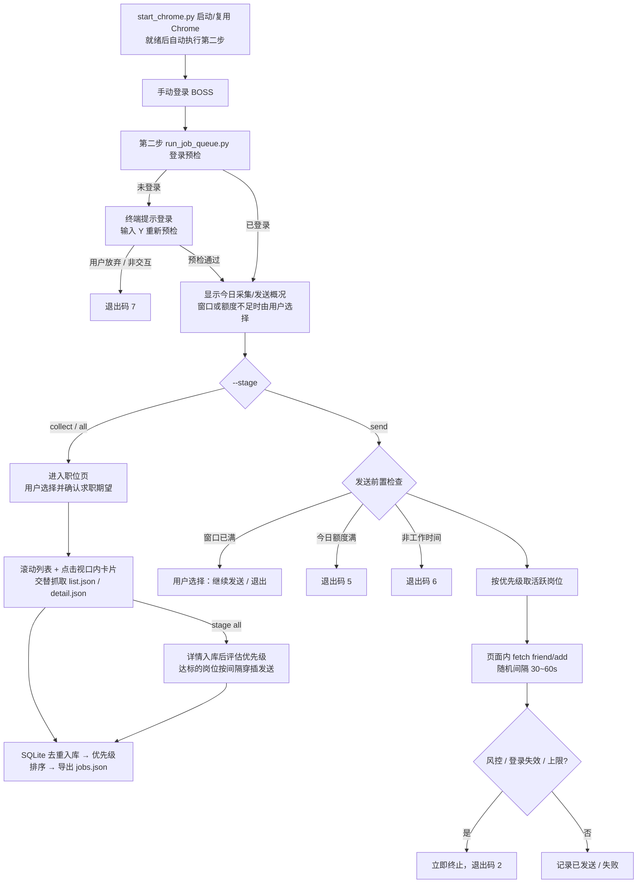

# BOSS 直聘自动采集与打招呼

在已登录的真实 Chrome 页面里完成「采集岗位 → 整理入库 → 按优先级打招呼」，不直接拼接口请求，避免额外的风控特征。`--stage all` 会在浏览详情时按优先级穿插发送，`--stage send` 用于批量补发积压岗位。

## 工作流程



### 一键启动（推荐）

```bash
python start_chrome.py                  # 启动/复用 Chrome，就绪后自动采集 + 穿插发送
python start_chrome.py --stage collect  # 只采集，不发送
python start_chrome.py --stage all --dry-run  # 干跑：采集 + 记录发送决策
python start_chrome.py --stage send     # 只批量补发积压
python start_chrome.py --no-run         # 只启动 Chrome，不自动执行
```

- 调试端口已在监听时直接复用，不会重复开窗口。
- Chrome 就绪后自动执行第二步，默认 `--stage all`（采集 + 穿插发送），不需要再敲第二条命令；只想采集时加 `--stage collect`。
- 未登录时终端会提示你先在 Chrome 里登录，输入 `Y` 重新预检，通过后自动继续。
- 登录态保存在 `.chrome-profile` 里，下次启动通常不需要重复登录。

### 也可以分开执行

```bash
python run_job_queue.py                 # 采集 + 穿插发送
python run_job_queue.py --stage collect # 只采集整理
python run_job_queue.py --stage send    # 只批量补发积压
python run_job_queue.py --diagnose      # 只检查登录 / token，不发请求
```

执行前会先做登录预检。未登录时终端会提示你先在 Chrome 里登录，输入 `Y/y/yes` 后重新预检，通过后自动进入下一步；输入 `q` 退出（退出码 7）。

采集开始前，脚本会先进入职位页并读取求职期望，在终端列出编号。你选择编号并确认后，才会切换期望并开始采集；城市取自所选期望末尾括号里的城市（例如「全栈工程师(杭州)」→ 杭州），并用列表返回做校验。`--expect-index` / `--expect-city` 只作为默认选项，仍然需要你确认。

## 采集流程（--collect-mode page，默认）

1. 确认在 `/web/geek/jobs`，不在则通过导航栏「职位」进入。
2. 确认已登录、岗位列表 DOM 已渲染后再开始。
3. 读取求职期望标签（排除「推荐」），在终端列出并等待用户选择、确认；城市从所选期望文本中解析，并通过列表返回校验。
4. 列表与详情交替采集：
   - 每次随机滚动 180~420 / 420~850 / 850~1300 px 三档之一，拆成 1~3 段，段间随机停顿；
   - 每一轮只点击**当前视口内可见**的 0~2 个岗位卡片，点击点每次随机，且不会先用 `scrollIntoView` 跳转；
   - 只抓浏览器自己发出的 `recommend/list.json` 和 `job/detail.json` 响应，不直接请求接口；
   - 已有详情的岗位自动跳过；
   - 详情拿到后立即入库；`--stage all` 时只在后台做发送决策，不改变滚动、点击、停留和分心节奏。
5. 随机化行为：鼠标分步弧线移动、速度不均、点击前随机悬停、岗位停留 3~6s（约 10% 概率延长 6~14s）；低概率插入切换标签页、切换应用、切到「消息」页再回职位页等分心动作。
6. 按 `encryptJobId` 去重覆写，写入 SQLite；按关键词（AI / 大模型 / JS / TS / Node / Python 等）计算优先级，导出精简 `jobs.json`。

## 数据来源与抓包工具

默认的页面模式不依赖 Reqable，数据都来自真实 Chrome：

| 数据 | 页面模式（默认） | API 备用模式 |
| --- | --- | --- |
| 求职期望 | 读取页面 DOM 的 `a.expect-item`（排除「推荐」） | 页面内 fetch `expect/list.json`，另存 `data/zhipin/expects.json` |
| 岗位列表 | 监听浏览器自己发出的 `recommend/job/list.json` 响应 | 页面内 fetch，参数取自 `params/list_params.json` |
| 岗位详情 | 监听浏览器自己发出的 `job/detail.json` 响应 | 页面内 fetch |
| token / zp_token | 发请求前在页面上下文读取 localStorage / sessionStorage / cookie 中含 token 的键；`zp_token` 默认取 cookie `bst` | 同左，也可用 `--token` / `--zp-token` 或 `data/browser_auth.json` 覆盖 |
| 登录判断 | cookie `bst` 或页面 token 候选存在 | 同左 |

说明：

- 列表/详情接口的响应匹配路径在 `browser/cdp_client.py`，实际请求地址（期望、详情、发送）在 `core/config.py`，都是早期用 Reqable 确认后固化到代码里的；日常运行不需要实时抓包。
- `params/list_params.json` 只是 API 备用模式的列表参数，页面模式不读取。
- `collect_apis.py` 是独立的 Reqable 采集工具，仅在接口变更、需要重新确认端点或参数时使用，不参与日常流程。
- `data/browser_auth.json` 是 token 的可选覆盖缓存，脚本只读不刷新；超过 12 小时未更新会在启动时提醒，过期后删除并改用页面实时 token，或重新抓取更新。

## 发送流程

### 启动概况

每次启动先显示今日概况，不需要浏览器：

```text
[今日概况]
  采集：列表 225 条，详情成功 120 条
  发送：50/150，失败 0
  2 小时窗口：12/30，还可发送 18 条
```

窗口已满时由用户选择：

1. 只采集，不发送（默认）
2. 继续发送（忽略 2 小时窗口，风险自负）
3. 退出

继续发送只忽略窗口，不突破每日 150 条硬上限；`--stage send` 只有「退出等待 / 继续发送」两个选项。

### 发送规则

- **滚动窗口**：任意 2 小时内最多 30 条；窗口长度可用 `--cooldown-hours` / `--window-hours` 调整。
- **每日上限**：默认 150 条（`--daily-limit`），这也是 BOSS 的每日沟通硬上限。
- **发送间隔**：每条 30~60 秒随机。
- **工作时间**：默认周一至周五 09:00~18:00，每条发送前再检查一次；`--ignore-work-hours` 仅用于当天特批。
- **候选人**：详情成功、职位未失效、boss 今日/3 日内活跃、未成功发送过；按优先级从池子里取。
- **单次运行上限**：`--send-limit`，默认 30，最大 30。

发送时在页面内调用 `friend/add`，只有接口正常返回 `code=0` 才记为 `sent` 并写入 `sent_at`；失败记 `failed` 和原因。遇到风控（环境异常 / 安全验证 / 验证码）、登录失效、沟通上限、token 缺失，立即终止整个队列。0 发送的 token / 连接失败不占用发送窗口。

### 发送模式

**`--stage all`：采集 + 穿插发送（默认）**

```bash
python run_job_queue.py --stage all
```

- 详情入库后立即计算优先级，达标且 boss 活跃的岗位进入待发队列；
- 前 `--inline-warmup` 个详情只浏览不发送（默认 3），之后才开始考虑；
- 优先级门槛 `--inline-min-priority`（默认 6），达标岗位还有 10% 概率随机跳过（`--inline-skip-rate`）；
- 发送间隔仍是 30~60 秒，到点才发，不打断滚动和点击；
- 达标岗位不会立刻发，先排队，避免“看到就发”的机械感；
- 采集结束后本轮不再追加批量发送，剩余岗位留给 `--stage send`；
- 风控 / 登录失效 / 沟通上限仍然立即终止整轮；单个岗位普通错误记录后继续。

**`--stage send`：批量补发积压**

```bash
python run_job_queue.py --stage send
```

不采集，只从数据库里按优先级取未发送的活跃岗位，受同一个 2 小时窗口和每日额度约束。

**干跑：只记录发送决策**

```bash
python run_job_queue.py --stage all --dry-run
```

正常采集和计算优先级，只打印「本应发送谁」，不调用 `friend/add`、不写发送记录、不消耗窗口和每日额度。想加快节奏可加 `--send-min-delay 1 --send-max-delay 2`。

## 目录结构

```
api-screener/
├── start_chrome.py      启动/复用 Chrome，就绪后自动执行第二步
├── run_job_queue.py     薄入口：单实例锁 + 调用 workflow.cli.main + 退出处理
├── collect_apis.py      独立工具：从 Reqable 采集接口信息（非日常流程）
├── core/                基础设施
│   ├── config.py        路径、接口地址、发送额度、退出码、风控关键词
│   ├── errors.py        业务异常 AbortError
│   ├── utils.py         时间 / URL / 响应校验 / 工作时间判断
│   ├── lock.py          单实例锁（data/run.lock）
│   └── console.py       终端输出：横幅、步骤、结束提示
├── browser/             浏览器交互
│   ├── cdp_client.py    原生 CDP 客户端（只发 Runtime.evaluate，不启用 Runtime 域）
│   ├── page_collect.py  页面采集：期望选择、滚动、可见卡片点击、随机行为
│   ├── os_input.py      Windows 原生滚轮 / 窗口前台控制
│   └── auth.py          登录预检、token 读取、CDP 客户端工厂
├── workflow/            业务流程
│   ├── cli.py           命令行参数、校验与主流程编排
│   ├── queue_runner.py  顺序任务队列：随机间隔、终止、运行摘要
│   ├── expectations.py  求职期望：接口/页面选择与期望任务
│   ├── collecting.py    采集与入库：页面抓包（默认）和 API 备用
│   ├── sending.py       采集穿插发送 / 批量发送与额度控制
│   └── startup.py       启动概况与 2 小时窗口决策
├── storage/
│   └── job_store.py     SQLite 入库、优先级、发送记录、导出
├── agents.md            长期约定与防风控细节（改动前必读）
├── params/
│   └── list_params.json API 模式使用的列表接口参数
└── data/
    ├── zhipin/zhipin.db        岗位库（主数据）
    ├── zhipin/jobs.json        导出的精简岗位列表
    ├── zhipin/send_log.jsonl   发送日志
    ├── zhipin/expects.json     求职期望快照
    ├── screen/queue_result.json 最近一次运行结果
    └── browser_auth.json       可选：手动指定 token / zp_token
```

## 环境要求

- Windows 10/11
- Python 3.10+
- Google Chrome
- 第三方依赖：`websocket-client`

```bash
pip install websocket-client
```

项目已不再使用 Playwright。

## 常用参数

| 参数 | 默认值 | 说明 |
| --- | --- | --- |
| `--stage` | `all` | `all` / `collect` / `send` |
| `--diagnose` | - | 只检查页面、登录、token |
| `--dry-run` | - | 干跑：采集并记录发送决策，不真正发送 |
| `--inline-min-priority` | `6` | 穿插发送的最低优先级分数 |
| `--inline-warmup` | `3` | 前 N 个详情只浏览不发送 |
| `--inline-skip-rate` | `0.1` | 达标岗位的随机跳过概率 |
| `--force-window` | - | 忽略 2 小时发送窗口（风险自负） |
| `--expect-city` | `杭州` | 期望选择的默认城市，所选期望无城市时作为回退 |
| `--expect-index` | `0` | 期望选择的默认编号，0=按城市推荐 |
| `--input-mode` | `os` | 滚轮方式：`os` 原生滚轮，失败自动回退 `cdp` |
| `--list-target` | =`--detail-limit` | 列表最多采集多少条 |
| `--detail-limit` | `150` | 最多采集多少条详情 |
| `--max-scrolls` | `150` | 最多滚动次数 |
| `--scroll-min-delay` / `--scroll-max-delay` | `2` / `4` | 滚动间隔（秒） |
| `--detail-min-delay` / `--detail-max-delay` | `3` / `6` | 岗位停留间隔（秒） |
| `--send-limit` | `30` | 单次运行发送上限，最大 30 |
| `--daily-limit` | `150` | 每日发送上限（BOSS 硬上限 150） |
| `--send-min-delay` / `--send-max-delay` | `30` / `60` | 发送间隔（秒） |
| `--cooldown-hours` / `--window-hours` | `2` | 发送滚动窗口小时数 |
| `--work-start` / `--work-end` | `09:00` / `18:00` | 允许发送的时间段 |
| `--work-days` | `1,2,3,4,5` | 允许发送的星期 |
| `--ignore-work-hours` | - | 临时忽略工作日/工作时间 |
| `--token` / `--zp-token` | - | 手动指定发送所需请求头 |
| `--auth-file` | `data/browser_auth.json` | token / zp_token 的 JSON 文件 |
| `--collect-mode` | `page` | `page` 页面抓包；`api` 直接请求（不推荐） |
| `--cdp-url` | `http://127.0.0.1:9222` | Chrome 调试端口 |
| `--no-run` | - | 仅 `start_chrome.py`：只启动/复用 Chrome，不自动执行第二步 |

## 退出码

| 退出码 | 含义 |
| --- | --- |
| 0 | 完成（或没有可发送岗位） |
| 2 | 异常终止（风控、登录失效、上限、token 缺失、页面采集失败等） |
| 3 | 手动停止 |
| 4 | 2 小时发送窗口已满 |
| 5 | 当日额度已用完 |
| 6 | 非工作日 / 非工作时间 |
| 7 | 未登录（用户放弃登录或终端非交互） |

## 常见问题

**未登录 / 想继续登录**

- 按终端提示在 Chrome 里完成登录，然后输入 `Y/y/yes` 重新预检；输入 `q` 退出。

**终端无法交互**

- 采集前需要用户选择求职期望，必须在可交互终端中运行；重定向、计划任务等环境会在登录确认或期望选择阶段退出。

**调试端口连不上**

- 确认 `start_chrome.py` 已执行，且 Chrome 窗口没有被关闭。
- 某些 IDE/沙箱会在命令结束时回收子进程；如果端口刚启动就消失，把 Chrome 放到一个持续运行的终端里，或手动执行脚本打印的启动命令。

**发送时报 `auth_missing ['token']`**

先看调试 Chrome 是否还在运行（窗口是否还在、9222 端口是否可访问）。脚本在 token 缺失时也会自动判断并打印对应命令：

- **Chrome 已关闭**：重新启动脚本，会自动启动 Chrome 并走登录预检，然后继续发送：

```powershell
python start_chrome.py --stage send
```

- **Chrome 还在**：不需要手动抓 token，重新执行脚本，先走登录预检再发送：

```powershell
python run_job_queue.py --stage send
```

  未登录时按提示输入 `Y` 重新预检。

这类 0 发送的 token / 连接失败不占用 2 小时发送窗口，修复后可以直接重试。只有需要临时覆盖时才使用 `--token` / `--zp-token` 或 `data/browser_auth.json`。

**2 小时窗口已满**

- 启动时选 `1` 只采集，或选 `2` 忽略窗口继续发送（风险自负），也可以等窗口释放。
- 采集本身不受窗口限制，只有发送受限制。
- 非交互环境想强制忽略窗口，可加 `--force-window`。

**干跑会真的发送吗**

- 不会。`--dry-run` 只采集、计算优先级并打印“本应发送谁”，不调用 `friend/add`、不写发送记录、不消耗窗口和每日额度。

**提示 database is locked / 已有另一个 run_job_queue 在运行**

- 同一时间只允许一个脚本操作页面和数据库；先退出另一个 `run_job_queue` / `start_chrome` 终端。
- 单实例锁在 `data/run.lock`；进程正常退出或异常终止后锁会自动释放。
- 不要同时开两个采集/发送；第二个进程会在启动时直接退出，不会操作页面。

**采集时提示原生滚轮不可用 / 输入超时**

- 保持 Chrome 窗口可见，不要最小化或完全遮挡；脚本会尝试还原并切到前台。
- 采集期间不要手动操作鼠标、键盘或切换窗口。

**被窗口或额度拦住**

- 窗口：启动时选只采集，或选继续发送（风险自负），也可以等窗口释放；非交互环境可用 `--force-window`。
- 额度：等到第二天；默认已是 BOSS 硬上限 150，不建议再调高。

## 注意

- 仅用于个人求职场景，请控制频率，遵守平台规则。
- 发送成功只以接口正常返回为准，不保存返回体；一旦被风控打断立即停止。
